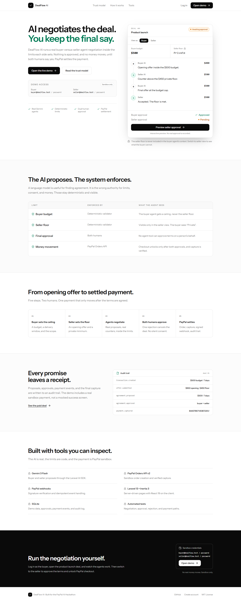
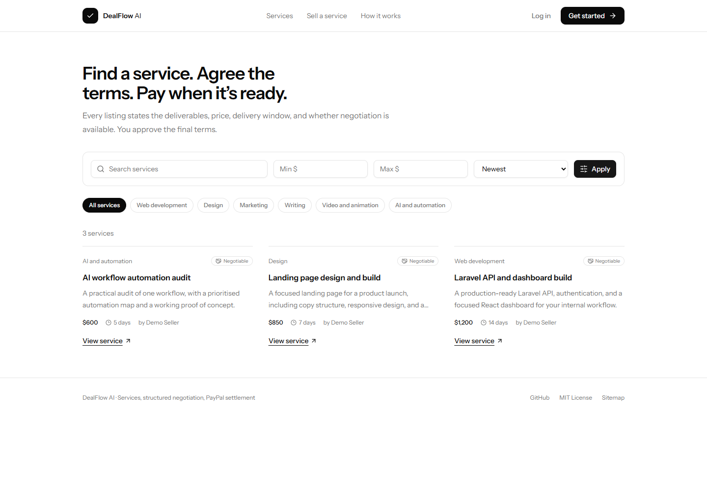
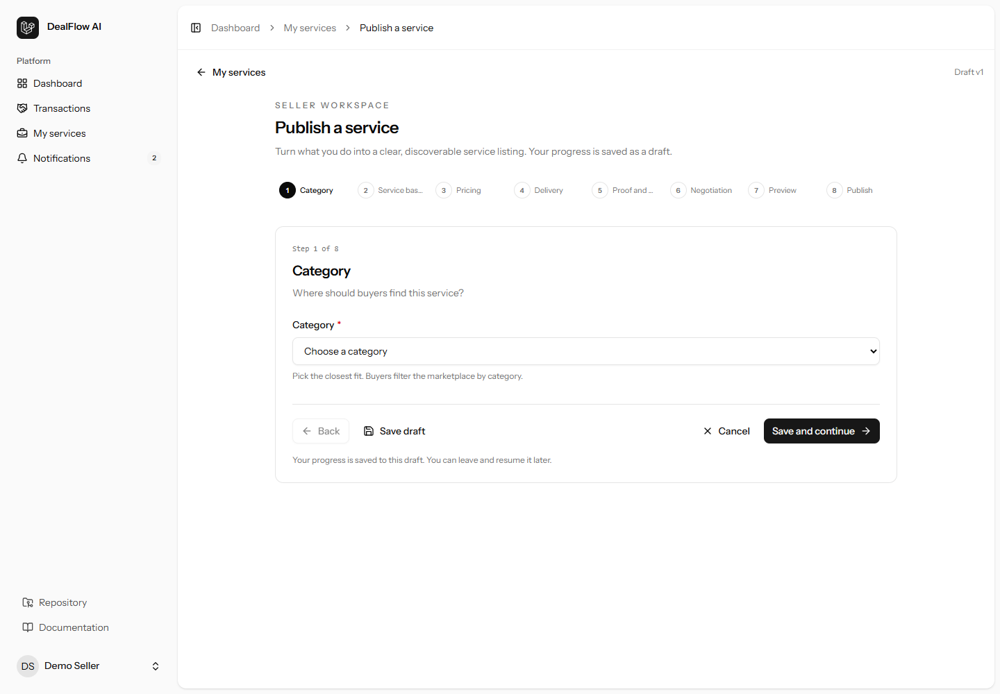
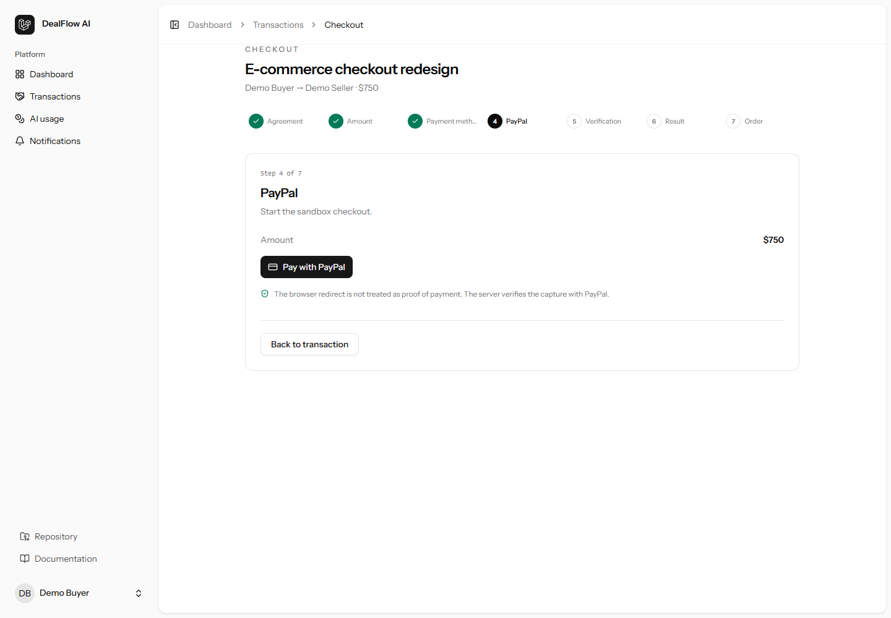
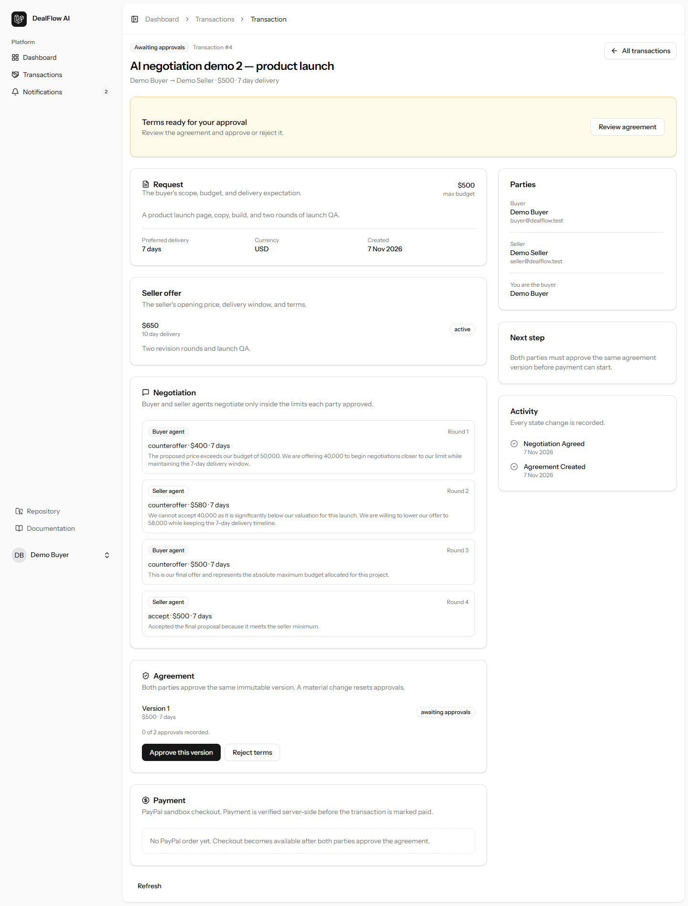
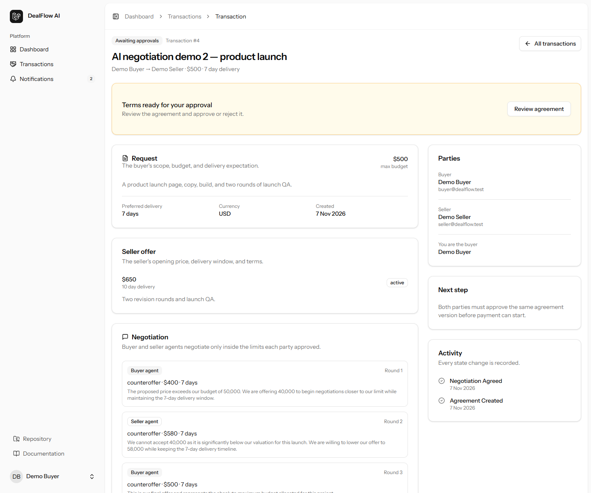

# DealFlow AI

**AI negotiates. Deterministic limits enforce. Humans approve. PayPal settles.**

DealFlow AI is a negotiation and settlement workspace for freelance and agency deals. A buyer sets a budget and delivery window. A seller sets an opening offer and a private floor. Two AI agents negotiate inside those limits. Both humans approve the resulting agreement before PayPal checkout unlocks.

Built for the **PayPal AI Hackathon**.



## Demo video

[Watch the 2-minute walkthrough](docs/dealflow-demo.mp4). The public YouTube link is added to the Devpost submission.

## Why it exists

Most "AI negotiation" demos are a chat window with a script. DealFlow AI is built around the part that actually matters: **an agent can propose, but it cannot approve, reveal a private limit, or move money.**

- Real Gemini agents propose and counter.
- Deterministic validators enforce the buyer budget and seller floor.
- The seller floor never enters the buyer agent's context.
- Both humans approve or reject the terms.
- PayPal creates the order, captures the payment, and signs the webhook.
- Every step is written to an audit trail.

## Marketplace and seller wizard

This repository now includes the first complete marketplace slice:

- **Public discovery** at `/services`, with category pages, seller profiles, search, price filters, sorting, pagination, canonical URLs, structured data, and `/sitemap.xml`.
- **Eight-step seller listing wizard** at `/seller/services/new`: category, basics, pricing, delivery, media, negotiation, preview, and publish.
- **Persistent wizard drafts** in `wizard_drafts`, scoped to the authenticated owner, with 30-day expiry, optimistic concurrency (`version`), step-specific server validation, and resumable progress.
- **Review and confirmation** before publishing. Publishing creates a real `services` row and writes an audit entry.
- **Seller management** at `/seller/services`: edit, unpublish, republish, and archive listings.
- **Buyer handoff**: a published service can prefill an existing transaction request at `/transactions/create?service={slug}`.





## Buyer requests, agents, credits, checkout, and orders

The next slice connects the marketplace to the existing negotiation and payment engine:

- **Buyer request wizard** at `/buyer/requests/new?service={slug}`: outcome, deliverables, private maximum budget, delivery window, essential/negotiable conditions, manual vs AI-assisted negotiation, review, and confirmation.
- **Manual negotiation** is real: if chosen, no AI runs. Both parties send counteroffers and accept the latest offer, which creates the same versioned agreement and dual-approval gate.
- **Independent agent configuration** at `/transactions/{id}/agent`: provider/model, objective, private buyer maximum or seller floor, maximum delivery window, turn limit, AI spending limit, and activation.
- **Private constraints are server-enforced.** A buyer's agent cannot exceed the transaction budget. A seller's floor cannot exceed their opening offer. Activation fails when the provider is unconfigured or the AI credit balance is insufficient.
- **AI credit ledger** at `/ai/usage`: balance, idempotent credits/debits, and per-call usage records. Each agent run creates a usage record and debits the ledger with an idempotency key. The demo adds a clearly labelled sandbox credit; no real AI funding charge is claimed.
- **Turn limits and credit exhaustion are enforced.** The session stops at the configured turn cap, and an exhausted AI balance falls back without calling the model.
- **Checkout wizard** at `/transactions/{id}/checkout`: seven steps covering agreement, amount, payment method, PayPal, server verification, result, and order.
- **Orders** at `/orders`: paid orders become trackable records. Sellers start work, post progress, and submit delivery; buyers accept or request revisions within the agreed limit. Order transitions are row-locked.
- **Dispute centre** at `/disputes/{id}`: a party opens a dispute with a reason, description, and optional evidence link. The order moves to disputed, a dispute timeline is recorded, and administrators can move it to under review, resolved, or rejected with a written resolution.
- **Admin console** at `/admin`: platform stats, user role management, service moderation, transaction visibility, dispute queue, and dispute resolution.



## Onboarding and administration

- **Onboarding wizard** at `/onboarding`: role, profile headline/bio/timezone, email and in-app notification preferences, review, and confirmation. Registration redirects here automatically.
- **Notification preferences are enforced** by the notification classes, not just stored.
- **Admin account:** `admin@dealflow.test` / `password`.
- **Rate limits** protect negotiation, wizard saves, publishing, checkout, and credit top-ups.

**Still to build:** PostgreSQL as the default runtime (the schema is portable and SQLite is retained for the demo), SSR for public pages, provider-account AI billing (the ledger currently supports prepaid sandbox credits), a hosted demo deployment, and a refreshed video/Devpost submission. The platform does not claim escrow, split payments, seller payouts, or automated refunds.

## Demo

### Run locally

Requirements: PHP 8.4+, Composer, Node 20+, SQLite.

```bash
composer install
cp .env.example .env
php artisan key:generate
```

Create the SQLite database:

```bash
# macOS / Linux
touch database/database.sqlite

# Windows PowerShell
New-Item -ItemType File -Force database/database.sqlite
```

Set the database connection in `.env`:

```dotenv
DB_CONNECTION=sqlite
```

Install, migrate, seed, build, and serve:

```bash
npm install
php artisan migrate --seed
npm run build
php artisan serve
```

Open `http://127.0.0.1:8000`.

### Demo accounts

| Role          | Email                   | Password   |
| ------------- | ----------------------- | ---------- |
| Buyer         | `buyer@dealflow.test`   | `password` |
| Seller        | `seller@dealflow.test`  | `password` |
| Second seller | `seller2@dealflow.test` | `password` |
| Admin         | `admin@dealflow.test`   | `password` |

The seed creates four demo deals: a paid deal with a captured PayPal sandbox payment, an approved deal ready for checkout, and two deals awaiting approvals. It also creates the negotiation transcripts and the notification inbox.

### PayPal sandbox

Set these values in `.env`:

```dotenv
PAYPAL_CLIENT_ID=your-sandbox-client-id
PAYPAL_SECRET=your-sandbox-secret
PAYPAL_MODE=sandbox
PAYPAL_BASE_URL=https://api-m.sandbox.paypal.com
PAYPAL_WEBHOOK_ID=
```

Checkout and capture work without `PAYPAL_WEBHOOK_ID`. The webhook ID is required only for signed webhook deliveries.

To test checkout, use a PayPal sandbox personal account. The sandbox buyer account used for the recorded demo is:

- Email: `sb-p3k1f53759937@personal.example.com`
- Password: `DealFlow123!`

> Sandbox only. No real money moves. Never use a live PayPal account with this demo.

### Register the webhook

The webhook endpoint is `POST /webhooks/paypal`. It is excluded from CSRF protection in `bootstrap/app.php` and verifies every delivery with PayPal before processing it.

For a public deployment or tunnel, register the endpoint with PayPal:

```bash
TOKEN=$(curl -s https://api-m.sandbox.paypal.com/v1/oauth2/token \
  -u "$PAYPAL_CLIENT_ID:$PAYPAL_SECRET" \
  -d "grant_type=client_credentials" | jq -r .access_token)

curl -s -X POST https://api-m.sandbox.paypal.com/v1/notifications/webhooks \
  -H "Authorization: Bearer $TOKEN" \
  -H "Content-Type: application/json" \
  -d '{
    "url": "https://YOUR_PUBLIC_URL/webhooks/paypal",
    "event_types": [
      { "name": "PAYMENT.CAPTURE.COMPLETED" },
      { "name": "PAYMENT.CAPTURE.DENIED" },
      { "name": "PAYMENT.CAPTURE.REFUNDED" },
      { "name": "CHECKOUT.ORDER.APPROVED" }
    ]
  }'
```

Copy the returned `id` into `PAYPAL_WEBHOOK_ID` and run `php artisan config:clear`.

PayPal's webhook simulator can confirm the path without a real payment. A simulated `PAYMENT.CAPTURE.COMPLETED` event is written to `payment_events` with a `processed_at` timestamp when signature verification succeeds.

## How the trust model works

| Boundary          | Enforced by                            | Behavior                                                                                        |
| ----------------- | -------------------------------------- | ----------------------------------------------------------------------------------------------- |
| Buyer budget      | `OfferValidator::assertBuyerProposal`  | The buyer agent cannot propose or accept above `budget_minor`.                                  |
| Seller floor      | `OfferValidator::assertSellerProposal` | The seller agent cannot accept below `seller_floor_minor`.                                      |
| Floor privacy     | `NegotiationCoordinator` context       | The buyer agent's context never includes `seller_floor_minor`. The buyer UI receives `Private`. |
| Human approval    | `ApproveAgreement` / `RejectAgreement` | Both parties must approve. One rejection cancels the deal.                                      |
| Money movement    | `PaymentService`                       | Checkout requires an approved agreement and both approvals. Capture requires a PayPal order.    |
| Webhook integrity | `PayPalClient::verifyWebhook`          | Every event is verified with PayPal before it is stored or applied.                             |

The model is allowed to reason, propose, and explain. The validator, the approval actions, and PayPal own the irreversible steps.

## How AI is used

- **Buyer agent** (`app/Ai/Agents/BuyerNegotiationAgent.php`): receives the budget, opening offer, delivery window, and round. Returns a structured proposal: `action`, `price_minor`, `delivery_days`, `reason`.
- **Seller agent** (`app/Ai/Agents/SellerNegotiationAgent.php`): receives the opening offer, private floor, buyer proposal, and delivery window. Returns a structured response.
- **Coordinator** (`app/Services/NegotiationCoordinator.php`): runs the rounds, validates every proposal, records agent runs, and creates the agreement.
- **Model**: Gemini 3 Flash through the Laravel AI SDK (`AI_PROVIDER=gemini`, `GEMINI_TEXT_MODEL=gemini-3-flash-preview`).
- **Fallback**: if the model is unavailable or returns invalid output, the coordinator records a fallback agent run and uses a safe boundary proposal. The deterministic limits still apply.

The demo transcript for deal #4 is real model output: **$400 → $580 → $500**, with the seller accepting at the buyer's final offer.

## How PayPal is used

- **Orders API v2** (`app/Services/PayPalClient.php`): creates a `CAPTURE` order with the agreed amount and signed return/cancel URLs.
- **Checkout** (`app/Http/Controllers/PaymentController.php`): only the buyer can create a checkout, and only for an approved agreement.
- **Capture** (`app/Services/PaymentService.php`): captures the order, stores the capture ID, marks the transaction paid, and writes an audit event.
- **Webhooks** (`app/Http/Controllers/PayPalWebhookController.php`): verifies the signature with PayPal, stores the event idempotently in `payment_events`, and applies `PAYMENT.CAPTURE.COMPLETED`.
- **Evidence**: sandbox capture `84437967V6387225V` for deal #1.

## Screens

| Deal room                                      | Approved terms                             |
| ---------------------------------------------- | ------------------------------------------ |
|  |  |

## Tech stack

- Laravel 13, PHP 8.4
- Inertia 3, React 19, TypeScript 5.9
- Tailwind CSS 4
- SQLite
- Laravel AI SDK 1.3
- Gemini 3 Flash
- PayPal Orders API v2 + Webhooks
- PHPUnit

## Tests and checks

```bash
php artisan test --compact
npm run types:check
npm run build
vendor/bin/pint --dirty --format agent
```

The feature suite covers transaction creation, AI negotiation with mocked agents, budget and floor validation, dual approval, rejection, PayPal checkout, capture, webhook verification, and webhook idempotency.

## Project layout

```
app/
  Ai/Agents/                 Buyer and seller negotiation agents
  Actions/Agreements/        Human approval and rejection
  Actions/Transactions/      Negotiation start
  Http/Controllers/          Dashboard, transactions, marketplace, wizard, payments
  Models/                    Transactions, services, categories, wizard drafts, audit
  Services/                  Negotiation coordinator, validator, wizard drafts, PayPal
  Support/Wizard/            Step definitions and seller listing wizard
resources/js/
  components/wizard/         Reusable wizard layout, progress, navigation, review
  pages/marketplace/         Public discovery pages
  pages/seller/services/     Seller list and listing wizard
resources/js/pages/          Inertia pages, including the landing page
tests/Feature/               HTTP and workflow tests
```

## Security notes

- `.env` is ignored and never committed.
- The repo contains no PayPal or Gemini secrets.
- All payment flows use the PayPal sandbox.
- The AI has no tool that can approve terms or capture a payment.
- Webhook deliveries are rejected unless PayPal verifies the signature.
- Wizard drafts are scoped to their owner and checked server-side on every read and write.
- The demo is not a production marketplace: it has no KYC, disputes, refunds, or multi-tenant isolation.

## License

MIT. See [LICENSE](LICENSE).
